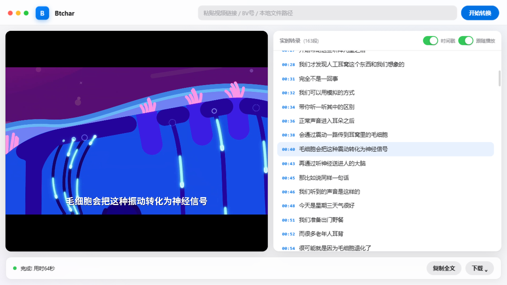

# Btchar

**视频转文字桌面应用** —— 左边看视频，右边实时出文字。

支持 B站 / YouTube / 抖音等主流平台链接（yt-dlp 支持的站点均可）以及本地视频文件，
转录全程本地运行，语音数据不经过任何第三方接口。

**Btchar** = **B**ili**bili** **t**o **char**acters。

> 📖 English docs: [README_EN.md](README_EN.md) · 协议: **CC BY-NC 4.0（仅限非商业使用）**

## 功能特性

- 🎬 **左边播放、右边转录**：每识别出一段立即显示，点任意文字跳转视频进度，播放时当前句自动高亮
- ⚡ **字幕优先策略**：B站视频优先直接抓取 AI/CC 字幕（登录后可用），秒出全稿零下载
- 🧠 **本地语音识别兜底**：[faster-whisper](https://github.com/SYSTRAN/faster-whisper)（CTranslate2 加速版 Whisper），语言自动检测，NVIDIA 显卡自动 GPU 加速（int8，RTX 5060 上约 60 倍实时），**界面可选 5 档模型**（极速/快速/均衡/高准/最高）
- ⏸ **可暂停续转**：转换中可暂停，保留已转录内容，继续时从断点接着识别（视频用缓存不重新下载）
- 📁 **四种导出格式**：TXT 纯文字 / TXT 带时间戳 / SRT 字幕 / MD 整理稿，保存时弹系统对话框自选路径
- 🔤 **时间戳显示开关**：一键切换纯文字阅读模式
- ✨ **一键 AI 摘要**：本地 TextRank 生成关键词 + 一句话摘要 + 要点时间线（点击跳转对应视频位置），可复制；全程无网络请求
- 🎙 **边播边转（两种模式）**：
  - **链接模式**——粘贴B站链接后点 🎙：视频像播放器一样**秒开流式播放**（不下载整个视频），字幕跟着播放进度增量识别
  - **声音模式**——不填链接点 🎙：捕获系统声音实时转文字（直播/网课/会议），左侧带屏幕画面镜像
- 🗂 **多标签并行**：像浏览器一样多开任务——每个标签独立的视频/转录/摘要，多个视频同时转换互不干扰
- 🛡 **字幕可信度校验**：B站字幕CDN偶发返回其他视频的字幕，已用「时长比对+音频内容抽查」双重防线拦截，脏字幕自动转本地识别
- 🍎 苹果（macOS/iOS）风格界面，原生独立窗口（WebView2，非浏览器）

## 界面预览



```
┌────────────────────────────────────────────────┐
│ ●●●  [B] Btchar   [ 视频链接输入框 ] [开始转换] │
├───────────────────────┬────────────────────────┤
│                       │ 实时转录 (229段)        │
│      视频播放器        │ 00:07 第一句话...      │
│                       │ 00:12 ▸当前句高亮       │
│                       │ ...                    │
├───────────────────────┴────────────────────────┤
│ ● 完成 ✓        [复制全文] [下载 ⌄]            │
└────────────────────────────────────────────────┘
```

## 安装（Windows + Python 3.9+）

**📦 快速下载**（免 git）：
[点击下载最新代码 ZIP](https://github.com/furongtao-7/Btchar/archive/refs/heads/main.zip)
· 国内加速：[镜像下载](https://ghproxy.net/https://github.com/furongtao-7/Btchar/archive/refs/heads/main.zip)
下载后解压到任意目录，进入下一步。

```bat
git clone https://github.com/furongtao-7/Btchar.git
cd Btchar
python -m venv .venv
.venv\Scripts\python -m pip install -r requirements.txt -i https://pypi.tuna.tsinghua.edu.cn/simple
```

> - 首次使用会自动下载语音识别模型（small 约 460MB）；huggingface.co 不可达时自动切换国内镜像 hf-mirror.com
> - GPU 加速（可选）：`.venv\Scripts\pip install nvidia-cublas-cu12 nvidia-cudnn-cu12`，程序自动发现并使用，缺失时自动回退 CPU
> - 不需要安装 ffmpeg——项目通过 `imageio-ffmpeg` 自带二进制

## 使用

### 桌面 App（推荐）

```bat
.venv\Scripts\pythonw app_native.py
```

或创建指向它的快捷方式（图标用 `Btchar.ico`）。B站扫码登录（开启AI字幕秒出）：
在App内点「扫码登录B站」或命令行执行 `v2t.bat login`。

**🎙 边播边转**：点顶栏「边播边转」开始，然后播放任何内容（网页视频、本地播放器、直播），
系统声音实时转成文字显示在右侧；「暂停收音」临时中断；「■ 停止并保存」结束并自动导出。
适合无法下载的视频、直播、在线会议等场景。

### 命令行（批量/高级用法）

```bat
v2t.bat https://www.bilibili.com/video/BV1GJ411x7h7 --srt --md
v2t.bat BV1GJ411x7h7                      :: BV号、b23.tv短链均可
v2t.bat 链接1 链接2 链接3                  :: 批量
v2t.bat 本地视频.mp4 --timestamps          :: 本地文件
v2t.bat BV号 --page 3                      :: B站多P视频
v2t.bat BV号 -m large-v3 --summary         :: 更高准确率模型 + 生成摘要文件
```

全部参数见 `v2t.bat --help`。输出保存到 `transcripts\`（txt + srt + md）。

## 工作原理

```
输入链接 → B站? → 有AI字幕? ─ 是 → 直接输出(秒出)
              │              └ 否 → 优选普通CDN下载音视频(校验时长, 避开PCDN脏数据)
              │                    → ffmpeg合成MP4 → 提取纯音轨 → faster-whisper流式识别
              └ 其他平台 → yt-dlp下载(720p内)
本地文件 → 提取音轨 → 识别
```

识别始终使用**纯音轨**（合成视频直接解码会产生乱码输出）；GPU 用 int8 精度
（float16 在 RTX 50 系 Blackwell 上会静默输出空结果）。

## 安全设计

- **本地闭环**：服务只监听 `127.0.0.1`，不暴露局域网
- **SSRF 防护**：所有对外请求校验协议/域名/解析 IP（拒绝内网、环回、链路本地地址），逐跳重定向复检，DNS 钉扎防 rebinding（线程局部实现）
- **命令白名单**：仅允许调用 venv 内的白名单二进制（ffmpeg），参数列表形式，禁 shell
- **路径穿越防护**：所有外部输入的文件名收敛在指定目录内，越界直接拒绝
- **CSRF 防护**：写操作校验 Origin/Host 指向本服务
- **隐私**：B站登录凭证仅存本地 `bili_login_cookies.txt`（已被 .gitignore 排除），请勿分享

## 运行测试

```bat
.venv\Scripts\python test_v2t.py
```

覆盖：字幕解析、中文优先级、输出格式、路径穿越拦截。

## 常见问题

- **AI字幕拿不到**：B站AI字幕需要登录态且为懒生成（首查为空时程序会等待重试），仍无则自动转本地识别
- **下载失败**：程序自动获取B站匿名 cookie 绕过 412 风控，并优先 upos 普通CDN（PCDN 节点会返回错误内容并已做时长校验）
- **纯音乐视频识别为"♪ 音乐"或空**：属正常，Whisper 面向语音内容
- **登录失效**：重新 `v2t.bat login` 扫码

## 打包为 exe（可选）

运行 `build_exe.bat`（PyInstaller 打包到 `dist\Btchar\`，整个文件夹一起分发）。
打包前建议先用 App 完整转换一次确保依赖就绪；目标机器无需安装 Python。

## 项目文件

| 文件 | 说明 |
| --- | --- |
| `app_native.py` | **主入口**：原生窗口App（WebView2） |
| `webapp.py` | 网页服务核心（本地127.0.0.1服务 + Edge窗口备用入口） |
| `v2t.py` | 转换引擎核心（命令行入口 + 供App调用） |
| `summarizer.py` | 本地AI摘要（TextRank + 分词回退，零网络请求） |
| `livetrans.py` | 边播边转引擎（系统声音回环采集 + VAD分句 + 流式识别） |
| `static/index.html` | App 界面（苹果风格双栏） |
| `Btchar.ico` / `docs/` | 应用图标 / 截图 |
| `test_v2t.py` | 回归测试（字幕解析、输出格式、路径安全） |
| `v2t.bat` / `build_exe.bat` | 命令行入口 / exe打包脚本 |
| `.github/workflows/tests.yml` | CI：自动跑回归测试 |

## 免责声明

本项目仅供个人学习与技术研究。使用时请遵守各视频平台的服务条款与相关法律法规，
请勿用于侵犯版权或其他用途。B站登录凭证仅在本机使用，请妥善保管。

## License

[CC BY-NC 4.0](LICENSE) —— **仅限非商业使用**。商业使用需联系仓库所有者获得授权。

## 致谢与参考

- [yt-dlp](https://github.com/yt-dlp/yt-dlp) —— 通用视频下载引擎
- [SYSTRAN/faster-whisper](https://github.com/SYSTRAN/faster-whisper) —— CTranslate2 版 Whisper
- [openai/whisper](https://github.com/openai/whisper) —— 原始 Whisper 模型
- [pywebview](https://github.com/r0x0r/pywebview) —— 原生窗口
- [lanbinleo/bili2text](https://github.com/lanbinleo/bili2text)、[imlewc/video-to-subtitle-summary-skill](https://github.com/imlewc/video-to-subtitle-summary-skill) —— 流程参考
